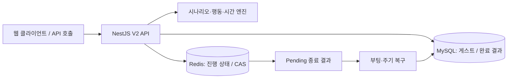

# Project IF

> **2026-11-19 진행 현황:** 현재 작업 기준은 `wip/f1-timeline-integration` 브랜치입니다. 11월 18일 사용자 로컬 기준 **26파일·203/203 테스트 통과, Nest 빌드 성공**이 보고됐습니다. 상대 시간 이벤트 통합, 화재 X/Y/Z 세계선, 화재 대표 경로 검증, 행동 이력의 Redis·MySQL 저장까지 반영됐습니다. 11월 19일에는 개발용 Playground의 종료 후 행동 이력 표시 코드도 추가됐으며 **로컬 화면·전체 테스트 재검증은 아직 남았습니다.** 상세 최신 진행과 다음 개발 블록은 [2026-11-19 개발 인계](docs/DEVELOPMENT_STATUS_20261119.md)를 우선 참고하세요. 아래의 11월 17일 현황 표는 과거 기준 기록입니다.

**선택이 상황을 바꾸고, 누적된 판단이 결말을 만드는 인터랙티브 시나리오 서비스**

Project IF는 재난·생존 상황에서 사용자가 행동을 선택하고, 그 결과가 다음 상황에 반영되는 웹 서비스를 목표로 합니다. 하나의 행동이 언제나 정답이나 오답인 것은 아닙니다. **현재 위치, 자원, 확보한 정보, 세계의 숨겨진 상태, 경과 시간**에 따라 같은 선택도 다른 결과로 이어질 수 있습니다.

현재는 **백엔드 V2 엔진을 개발 중인 프로젝트**이며, 웹 화면과 공개 배포는 아직 완료되지 않았습니다. 최초 공개는 **아파트 화재 시나리오 1종**을 목표로 하며, 이후 정전·조난·침수 시나리오를 추가할 계획입니다.

> **현재 상태 (2026-11-17, 원격 `main` 코드 확인 기준)**  
> V2 API, 상태 기반 행동 처리, Redis 버전 CAS, MySQL 종료 결과 저장, Redis Pending 복구 경로를 구현했습니다. **완성된 화재 시나리오, 행동 이력·엔딩 크레딧, 단일 이어하기, 웹 UI, 배포는 개발 예정**입니다. 문서에 기재된 정책이 곧 구현 완료를 의미하지는 않습니다.

## 어떤 경험을 만들고 있나요?

1. **상황 확인:** 제한된 정보 속에서 현재 장면과 가능한 행동을 확인합니다.
2. **행동 선택:** 신고, 정보 확인, 이동, 대기 등 상황에 맞는 행동을 선택합니다.
3. **상태 변화:** 선택으로 게임 속 시간이 흐르고 환경·자원·지식이 변화합니다.
4. **분기와 결말:** 누적된 상태와 행동에 따라 다른 장면 또는 성공·실패 엔딩으로 이어집니다.
5. **선택 되돌아보기 (예정):** 종료 후 엔딩 크레딧에서 자신의 행동 순서와 주요 판단의 근거를 살펴봅니다.

단순한 2지선다 퀴즈나 공통 점수 경쟁을 지향하지 않습니다. **V1의 점수·등급형 엔진은 초기 프로토타입**으로 남겨두고, V2 재난 시나리오는 **상태·조건·시간·엔딩 중심**으로 개발합니다.

## 현재 구현 상태

| 영역 | 현재 구현 | 남은 작업 |
|---|---|---|
| V2 시나리오 엔진 | JSON 로딩·기본 검증, 조건/효과 처리, STAY·GOTO·END, 절대 시각 이벤트 | RC2.1 계약과의 차이 보완, 4종 공통 요구사항 검토, 실제 콘텐츠 통합 |
| 플레이 API | 시작·조회·행동 제출, 공개용 View 생성, 게스트 소유권 검사 | 단일 이어하기, 포기하기, 시나리오 목록, 행동 이력·리뷰 조회 |
| Redis | 플레이 TTL 1시간, Lua 기반 버전 CAS, 종료 Pending 원자 기록 | 활성 이어하기 슬롯 관리, 중복 시작·포기 경합 검증 |
| MySQL | 게스트 사용자·세션, V2 성공/실패 종료 결과, 중복 결과 일치 검사 | 게스트 인증 7일 반영, 완료한 행동 이력 영속화 |
| 장애 복구 | 부팅 시 및 60초 간격으로 V1/V2 Pending 재저장 시도 | 행동 이력까지 포함한 복구 경로 검증, 운영 환경 검토 |
| 콘텐츠·화면 | V2 화재 엔진 테스트용 JSON | 완결된 화재 플레이, 엔딩 크레딧 UI, 예외/만료 화면 |
| 실행·배포 | 로컬 NestJS·Redis·MySQL 기반 개발, Vitest 테스트 코드 | 전체 테스트 최신 실행 확인, DB 초기화 자동화, Docker/CI, 배포 |

**주의:** 현재 저장소의 `data/apartment_fire_01.json`은 **단일 장면 테스트용 데이터**입니다. 신고 행동 이후 정식 엔딩으로 도달하는 완결된 공개 시나리오가 아닙니다.

### 주요 백엔드 설계

**1. Redis 버전 CAS로 동시 행동 제어**  
클라이언트는 현재 플레이의 `version`을 `expectedVersion`으로 전송합니다. Redis Lua 스크립트는 저장된 버전·진행 상태·플레이 식별 정보를 확인한 뒤 조건을 만족하는 요청만 상태를 갱신합니다. 동일 버전의 경쟁 요청이 모두 반영되는 것을 방지합니다. **동일 요청에 과거 성공 응답을 그대로 돌려주는 `requestId` 멱등 처리와는 구분**합니다.

**2. Redis 플레이 상태와 MySQL 종료 결과 분리**  
진행 중 플레이는 Redis에 저장하고, 완료한 결과는 MySQL `user_play_log_v2`에 기록합니다. 종료 상태를 Redis에 반영할 때 Pending 결과도 함께 생성하고, DB 저장에 실패하면 Pending을 유지한 뒤 재시도합니다. MySQL은 같은 `play_id`·같은 내용의 재저장을 허용하고, 내용이 다른 중복 저장은 거절합니다. 이 설계가 Redis 자체 유실까지 방지하는 것은 아닙니다.

**3. 서버 내부 정보와 공개 View 분리**  
세계 상태(`world`), 플레이어 상태(`player`), 획득한 정보(`knowledge`)를 구분합니다. V2 API는 원시 세계 상태 전체 대신 현재 장면, 공개된 정보, 행동 가능 여부, 종료된 경우 엔딩 정보를 포함한 `PlayViewV2`를 반환합니다.

**4. 시간과 상태에 따른 결과 분기**  
행동은 `durationMinutes`만큼 게임 시간을 진행시키며, 지정 시각의 이벤트를 반영한 상태로 행동 결과를 판정합니다. 조건은 `EQ`, `NEQ`, `GT`, `GTE`, `LT`, `LTE`, `INCLUDES`, 효과는 `SET`, `ADD`, `APPEND_UNIQUE`, `REMOVE`를 지원합니다. 상대 시간 예약 이벤트 등 RC2.1의 일부 기능은 아직 미구현입니다.

## 구성과 데이터 흐름



- `api/src/plays/`: Controller, Service, V1/V2 엔진, 시나리오 검증·공개 View
- `api/src/redis/`: 플레이 상태·Lua CAS·Pending 저장
- `api/src/database/`: 게스트 식별·세션·완료 결과 저장
- `api/src/guest/`: 게스트 토큰 생성 및 해시
- `data/`: JSON 시나리오 데이터
- `docs/specs/`: 확정 제품 정책, 기능 요구사항, 구현 현황

## 기술 스택

| 구분 | 기술 |
|---|---|
| 런타임·언어 | Node.js, TypeScript |
| 백엔드 | NestJS 12 계열, REST API |
| 상태·동시성 | Redis, Lua CAS |
| 영속 저장소 | MySQL, `mysql2` |
| 검증·테스트 | `class-validator`, Vitest 4 계열 |
| 개발·형상관리 | npm, Git, GitHub |

> 프레임워크·라이브러리 버전은 `api/package.json`을 기준으로 기술했습니다. `README`에 고정된 로컬 Node.js/DB 버전이나 과거 테스트 개수는 최신 검증 결과로 오인하지 않도록 제외했습니다.

## V2 API (현재 구현)

| Method | 경로 | 동작 |
|---|---|---|
| `POST` | `/v2/plays` | 게스트 인증 후 V2 플레이 생성 |
| `GET` | `/v2/plays/:playId` | 게스트 소유권 확인 후 공개용 플레이 View 조회 |
| `POST` | `/v2/plays/:playId/actions` | 현재 버전에 대한 행동 제출 및 결과 반환 |

### 플레이 생성

```http
POST /v2/plays
Content-Type: application/json

{"scenarioId":"apartment_fire_01"}
```

응답은 `playId`와 `view`를 포함합니다. 신규 게스트에게는 HttpOnly `guest_token` 쿠키가 설정됩니다.

### 행동 제출

```http
POST /v2/plays/{playId}/actions
Content-Type: application/json
Cookie: guest_token=...

{"actionId":"E01-A","expectedVersion":0}
```

응답은 `resultText`와 갱신된 `view`를 포함합니다. 버전 충돌이나 이미 종료된 플레이의 추가 행동은 `409 Conflict`로 처리될 수 있습니다. **현재는 같은 요청을 다시 보냈을 때 이전 성공 응답을 반환하는 `requestId` 기능이 없습니다.**

> `/plays` 계열 V1 API도 초기 구현을 위해 남아 있습니다. 새로운 개발의 기준은 `/v2/plays`입니다.

## 로컬 실행

**사전 준비:** Node.js/npm, MySQL, Redis. MySQL 데이터베이스 및 필요한 테이블은 사전에 구성해야 합니다. 현재 자동 마이그레이션·Docker 실행 환경은 제공하지 않습니다.

1. 프로젝트 루트의 `.env.example`을 참고해 `.env`를 작성합니다. 인증 정보는 Git에 올리지 않습니다.

   ```env
   DB_HOST=127.0.0.1
   DB_PORT=3306
   DB_USER=project_if_app
   DB_PASSWORD=로컬에서_설정한_비밀번호
   DB_NAME=project_if
   ```

2. Redis와 MySQL을 시작하고, 프로젝트의 `api` 디렉터리에서 의존성을 설치·실행합니다.

   ```powershell
   cd api
   npm.cmd ci
   npm.cmd run start:dev
   ```

3. 서버 기본 주소는 `http://localhost:3000`입니다. V1 진단 경로로 기본 연결을 확인할 수 있습니다.

   ```powershell
   curl.exe http://localhost:3000/plays
   ```

**현재 코드 기준 참고:** Redis 연결 주소는 `redis.service.ts`에 `redis://127.0.0.1:6379`로 지정돼 있습니다. `.env.example`의 `REDIS_URL`을 변경하는 것만으로 연결 주소가 바뀌지는 않습니다.

### 테스트

```powershell
cd api
npm.cmd test
npm.cmd run build
```

Vitest 단위·통합 테스트를 포함합니다. **Redis/MySQL이 필요한 통합 테스트는 각 서비스와 테스트 DB 설정을 준비해야 합니다.** 이 README에서는 최신 전체 테스트를 직접 실행하지 않았으므로 통과 개수를 기재하지 않습니다.

## 확정된 서비스 정책과 개발 계획

2026-11-17에 다음 제품 정책을 결정했습니다. **이는 목표 동작이며, 현재 모든 항목이 구현된 것은 아닙니다.**

- 게스트 인증 **7일**. 진행 중 플레이는 **마지막 성공 행동으로부터 1시간** 동안 유지합니다. 단순 조회로는 연장하지 않습니다.
- 게스트당 **이어하기 대상 1개**. 이어하기/새로 시작하기를 제공하며 새로 시작할 때 기존 진행의 교체를 안내합니다.
- 명시적 포기는 `GIVEN_UP`으로 종료하되 MySQL 완료 기록에는 저장하지 않습니다. TTL 만료는 별도의 `EXPIRED` 상태 없이 처리합니다.
- V2 재난 시나리오는 공통 점수 대신 **상태 변화와 엔딩**을 중심으로 구성합니다.
- 종료 후에는 **행동 이력과 중요한 판단 근거를 보여주는 엔딩 크레딧**을 제공합니다. 완료한 플레이의 이력은 MySQL에도 보관합니다.
- **화재 시나리오 1종을 먼저 공개**합니다. 스키마 동결 전에는 정전·조난·침수의 구조적 요구사항도 함께 검토합니다.
- 회원가입, 다른 이용자의 선택 비율, 발견한 엔딩 수집은 **최초 공개 이후** 검토합니다.

보다 구체적인 기준과 실제 구현 여부는 아래 문서를 참고합니다.

- [V2 서비스 기능 명세서](docs/specs/PRODUCT_REQUIREMENTS_V2.md)
- [기능 명세 ↔ 구현 대조표](docs/specs/IMPLEMENTATION_MATRIX.md)

## 개발 배경과 향후 방향

V1은 TypeScript로 만든 단계·점수 기반 CLI 프로토타입에서 출발했습니다. 이후 장면·상태·행동·시간을 분리한 V2 엔진으로 재설계했고, NestJS HTTP API와 Redis/MySQL 저장·복구 구조를 연결했습니다.

다음 작업은 **4종 시나리오의 스키마 요구사항 확인 → 행동 이력·게스트 정책 구현 → 화재 1종 완결 통합 테스트 → 웹 UI·배포**입니다. 실제 코드와 시나리오 콘텐츠가 연결되는 시점에 재현 가능한 테스트 결과와 데모 화면을 추가할 예정입니다.

재난 시나리오는 실제 안전 지침을 참고하되, **시뮬레이션의 창작 설정과 실제 행동 지침을 구분**합니다. 공식적인 재난 대응 안내를 대체하지 않습니다.
