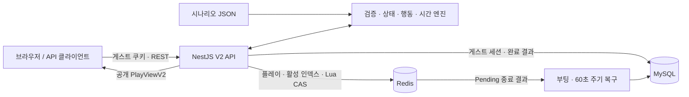

# Project IF

Project IF는 재난·생존 상황에서 사용자가 선택한 행동이 다음 장면과 결말을 바꾸는 인터랙티브 시나리오 프로젝트입니다. 같은 행동도 위치, 자원, 획득한 정보, 사건의 진행에 따라 다른 결과를 만듭니다. 시나리오 규칙을 JSON으로 선언하고 공통 엔진에서 실행하도록 설계해, 콘텐츠 작성과 플레이 상태 처리를 분리했습니다.

**백엔드 MVP 구현과 로컬 검증을 완료했습니다.** `wip/f1-timeline-integration`에서 NestJS 빌드와 Vitest 36개 파일·376개 테스트 통과를 확인했습니다. 최초 공개 목록은 **퇴근하겠습니다 (`office_fire_01`)** 한 작품으로 구성되어 있으며, 나머지 시나리오는 비공개입니다. 사용자용 프론트엔드와 공개 서비스 배포는 남아 있습니다.

## 아키텍처



Node.js와 TypeScript(ESM), NestJS 12 및 Express로 REST API를 구현했습니다. Redis와 Lua로 진행 상태와 동시성을 관리하고, MySQL(`mysql2`)에 게스트 세션과 완료 결과를 저장합니다. DTO 검증에는 `class-validator`, 테스트에는 Vitest 4와 Supertest를 사용합니다.

### 시나리오 엔진

등록된 JSON을 로드·검증한 뒤 장면, 행동, 조건, 효과, 엔딩을 공통 엔진에서 처리합니다. 내부 상태는 세계(`world`), 플레이어(`player`), 지식(`knowledge`)으로 구성됩니다. 공개 View에는 현재 장면과 획득한 정보, 행동별 실행 가능 여부가 담깁니다.

행동을 실행하면 `durationMinutes`만큼 가상 시간이 흐릅니다. 엔진은 그 구간의 절대 시각 이벤트와 예약된 상대 이벤트를 적용한 다음, 행동 시작·종료 시점의 상태와 시간을 참조해 일치하는 결과 하나를 고릅니다. 효과를 반영한 뒤 현재 장면 유지(`STAY`), 이동(`GOTO`), 종료(`END`)를 처리합니다. 상대 이벤트는 진행 중 행동의 상태 변화로 트리거가 거짓에서 참으로 바뀌면 행동 종료 시각을 기준으로 예약합니다. 다음 행동이 예정 시각에 도달하면 효과를 적용하고 처리 이력으로 중복 실행을 막습니다. 가상 시간은 사용자가 화면에 머무르는 동안 흐르지 않습니다.

### 플레이 생명주기와 일관성

- **게스트 인증** — 시작 시 게스트 토큰을 발급하거나 유효한 세션을 재사용합니다. 브라우저는 HttpOnly 쿠키를 보내고, 서버는 해시와 만료 시각을 MySQL에서 확인합니다. 세션은 발급 후 7일이며 플레이 ID 요청마다 소유권을 확인합니다.
- **생성·이어하기** — Redis Lua가 `play:v2` 상태와 `active:v2` 인덱스를 함께 생성합니다. 같은 게스트·시나리오에 진행 중 플레이가 있으면 중복 시작을 `409`로 거절합니다. 프론트엔드는 시나리오별 활성 조회에서 이어하기 대상을 찾습니다.
- **행동·포기** — Lua CAS가 저장된 버전, 진행 상태, 플레이의 식별 정보를 검사하고 한 요청만 같은 버전을 변경하도록 합니다. 시작과 변경 성공 시 플레이 TTL은 1시간이며 조회로 연장되지 않습니다. 진행 중에는 해당 활성 인덱스도 갱신됩니다. 성공·실패·포기 시 활성 인덱스가 제거되고, 포기 후 새 플레이를 시작할 수 있습니다.
- **완료 결과·복구** — 성공·실패 상태를 Redis에 기록할 때 TTL 없는 Pending 결과도 같은 Lua 실행에서 만듭니다. MySQL에 결과와 행동 이력을 저장한 뒤 Pending을 삭제합니다. 저장 경로에 장애가 나면 서버 부팅 시와 이후 60초 간격으로 재시도합니다. MySQL은 `playId`가 같고 내용도 같은 재저장을 허용합니다. 복구에는 Pending이 Redis에 남아 있어야 합니다.
- **행동 이력** — 성공적으로 반영된 행동의 장면, 문구, 결과와 가상 시각을 누적합니다. `CLEARED`·`FAILED`에서만 엔딩과 이력을 공개합니다. 포기·만료는 MySQL 완료 결과로 저장되지 않으며 Redis 만료 후 결과를 다시 조회하는 공개 API는 없습니다.

## API와 접근 정책

공개 V2 API 여섯 개는 시나리오 목록, 플레이 생성, 시나리오별 활성 조회, ID 조회, 행동, 포기를 제공합니다. 요청·응답과 오류 복구 흐름은 [V2 API 계약](docs/API_CONTRACT_V2.md)에 있습니다.

공개 목록에는 등록부에서 공개된 콘텐츠만 표시됩니다. 비공개 시나리오의 시작과 V1 `/plays` 접근은 로컬 루프백의 `development` 또는 `test`에서 허용됩니다. `/dev/scenarios`, `/dev/playground`, `/dev/plays/:playId/debug`는 루프백의 `development`에서만 열립니다. 디버그 조회에는 소유자 쿠키가 필요합니다. 운영에서 비공개 시나리오 시작, V1, 개발용 경로는 `404`입니다.

## 로컬 실행

1. Node.js 22.12 이상을 충족하는 런타임과 npm, MySQL, Redis를 준비합니다. MySQL 데이터베이스를 먼저 생성하고 그 데이터베이스에 [기본 스키마](db/schema.sql), [V2 결과 테이블](db/002_user_play_log_v2.sql), [행동 이력 컬럼](db/migrations/20261118_add_action_history_v2.sql) 순서로 적용합니다. 이력 마이그레이션은 컬럼이 없을 때 한 번 적용합니다.
2. 저장소 루트에서 [`.env.example`](.env.example)을 `.env`로 복사합니다. `DB_HOST`, `DB_PORT`, `DB_USER`, `DB_PASSWORD`, `DB_NAME`을 로컬 MySQL 설정에 맞추고 `REDIS_URL`을 지정합니다. Redis URL 기본값은 `redis://127.0.0.1:6379`, HTTP 포트 기본값은 `3000`입니다.
3. Redis와 MySQL을 실행하고 저장소 루트에서 다음을 실행합니다. 서버는 `api/`를 작업 디렉터리로 사용해 `../.env`, `../data/`, 개발 Playground의 `public/`을 해석합니다.

   ```powershell
   cd api
   npm.cmd ci
   $env:NODE_ENV = 'development'
   npm.cmd run start:dev
   ```

4. 별도 터미널에서 공개 목록을 확인합니다. 로컬 수동 플레이는 브라우저에서 `http://localhost:3000/dev/playground`를 엽니다.

   ```powershell
   curl.exe -i http://localhost:3000/v2/scenarios
   ```

### 검증

```powershell
cd api
npm.cmd run build
npm.cmd test
```

빌드에 성공했고 전체 Vitest 실행에서 **36개 파일·376/376 테스트**가 통과했습니다. 이 집계에는 개인 학습용 테스트도 포함됩니다. 서비스 검증 범위에는 엔진 단위 테스트, HTTP DTO·인증·접근 제한, Redis TTL·CAS, MySQL 결과·이력 저장, Pending 복구와 화재 시나리오 통합 테스트가 포함됩니다.

전체 테스트는 격리된 로컬 Redis/MySQL을 사용합니다. 일부 테스트의 Redis 정리 클라이언트는 `127.0.0.1:6379`를 사용하며, V1 통합 테스트에는 저장소 SQL에 없는 기존 `user_play_log` 테이블도 필요합니다. 개인 학습용 파일을 포함한 376개는 사용자 로컬 환경의 집계이므로 체크아웃에 포함된 테스트에 따라 파일 수가 달라질 수 있습니다. 배포 전 재현 조건은 [백엔드 릴리스 체크리스트](docs/BACKEND_RELEASE_CHECKLIST.md)에 기록했습니다.

## 다음 개발 범위

사용자용 프론트엔드는 공개 목록과 게스트 이어하기부터 연결합니다. 이후 장면·행동·오류·포기와 엔딩 이력 화면을 구성하고 모바일과 데스크톱에서 검증합니다. 공개 배포에는 환경·데이터베이스 초기화, 운영 보안과 복구, 실제 배포 환경 검증이 남아 있습니다. 비공개 시나리오는 각 콘텐츠를 검증한 뒤 공개 여부를 결정합니다.

- [V2 API 계약](docs/API_CONTRACT_V2.md)
- [백엔드 기능 동결 및 배포 체크리스트](docs/BACKEND_RELEASE_CHECKLIST.md)
- [V2 제품 요구사항](docs/PRODUCT_REQUIREMENTS_V2.md)
- [기능별 구현 대조표](docs/IMPLEMENTATION_MATRIX.md)
- [2026-11-19 개발 기록](docs/DEVELOPMENT_STATUS_20261119.md)
